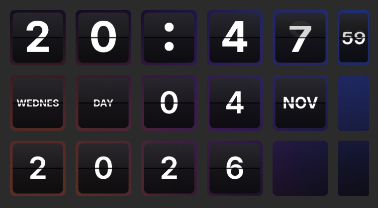

# Mira StreamDock Plugins

Custom plugins for the **MiraBox StreamDock** (built and tested on the 293S V3 on Windows 11):

| Plugin | What it does |
|---|---|
| **Wallpaper Clock** (`com.jay.wallclock`) | Turns a whole page into a wallpaper with a big live clock and date: one digit per key, plus seconds and AM/PM on the side screens. Flip-clock style, several fonts, and animated or video backgrounds. |
| **Govee Lamp** (`com.jay.govee`) | One key toggles a Govee Aura table lamp (H6052) over Bluetooth. The key shows live state: a bulb with rays and a glow in the lamp's colour when on, a plain grey bulb when off. |
| **Boom Audio** (`com.jay.boomaudio`) | One key cycles Boom 3D's output device (headset, speakers, monitors...) and shows the current device's icon. Boom's effects stay on. |

Plus `tools/govee-lamp`, a small desktop app and command line for the same lamp.



## Requirements

- MiraBox StreamDock software 2.9+ on Windows 10/11
- The **Govee Lamp** and **Boom Audio** plugins run a small Python helper:
  - Python 3.11+ (`pythonw` on PATH, or set its full path in `config.json`)
  - `pip install bleak websockets pillow` (Govee Lamp)
  - `pip install pycaw websockets pillow` (Boom Audio)

## Install

1. Quit StreamDock from the tray (right-click > **Exit**).
2. Copy the plugin folder(s) from `plugins/` into `%APPDATA%\HotSpot\StreamDock\plugins`.
3. For Govee Lamp / Boom Audio: copy `plugin/config.example.json` to `plugin/config.json` and edit it if needed (see below).
4. Start StreamDock and drag the action onto a key.

StreamDock only reloads plugin code after a full restart. Bump `Version` in `manifest.json` after changes.

## Configuration

**Govee Lamp** (`plugins/com.jay.govee.sdPlugin/plugin/config.json`)

```json
{ "python": "pythonw", "address": "" }
```

Leave `address` empty to use the first `Govee_H6052_*` lamp found nearby, or set your lamp's Bluetooth address. `python tools/govee-lamp/lamp.py scan` lists nearby lamps.

**Boom Audio** (`plugins/com.jay.boomaudio.sdPlugin/plugin/config.json`)

```json
{
  "devices": [
    { "match": "Delta",   "icon": "headset", "label": "DELTA II" },
    { "match": "Edifier", "icon": "monitor", "label": "MR5" }
  ]
}
```

`match` is part of the Windows playback-device name. Built-in icons are `headset`, `monitor` and `speakers`. The key presses Boom 3D's own *switch device* hotkey (default Ctrl+Shift+D, set `hotkey` to change it), so keep that hotkey enabled in Boom.

## Custom key art

Both helper plugins draw their keys in a "white glyph on transparent" style and accept your own artwork:

- **Boom Audio:** put a 144x144 white-on-transparent PNG at `images/glyph-<icon>.png` and use `<icon>` in `config.json`. `tools/boom-audio/dev/make_glyph.py` converts white-on-black artwork into one, sized and centred, with stray specks removed.
- **Govee Lamp:** put `images/bulb-mask.png` and `images/rays-mask.png` (white on black, the rays drawn separately) to replace the built-in bulb. Set `USE_TILE = True` in `plugin/keyart.py` to draw on a dark tile instead of a transparent background.

## How it works / notes

- **Govee H6052 protocol** (firmware 2.00.19): 20-byte packets written to `00010203-0405-0607-0809-0a0b0c0d2b11`, where the last byte is the XOR of the first 19. Power `33 01 01/00`, brightness `33 04 <1-100>`, colour `33 05 0D r g b`, white `33 05 0D FF FF FF kH kL r g b`, scene `33 05 04 lo hi`. Queries `AA 01` / `AA 04` / `AA 05 01` are answered on `...2b10`. See `tools/govee-lamp/govee_lamp.py`.
- The lamp accepts **one Bluetooth connection at a time**. The plugin connects only for a press or a 20-second status check, so the phone app still works.
- On Windows, connect with `use_cached_services=False`, because the cached service list is sometimes stale.
- **Boom 3D** sits between Windows and the real output, so switching the *Windows* default device would bypass Boom. Instead, the plugin finds which device Boom3D.exe has an active audio session on, and presses Boom's hotkey to move it.
- **StreamDock gotcha:** a Node plugin's `manifest.json` must declare `"Nodejs": {"Version": "20"}`, otherwise StreamDock never starts it.

## Credits & trademarks

- The clock's 7-segment font is **DSEG7** by keshikan, under the SIL Open Font License 1.1 (see `DSEG-LICENSE.txt`).
- Govee, Boom 3D, ASUS/ROG, Edifier and MiraBox/StreamDock are trademarks of their respective owners. This project isn't affiliated with or endorsed by any of them, and ships no brand logos.

## License

[MIT](LICENSE)
